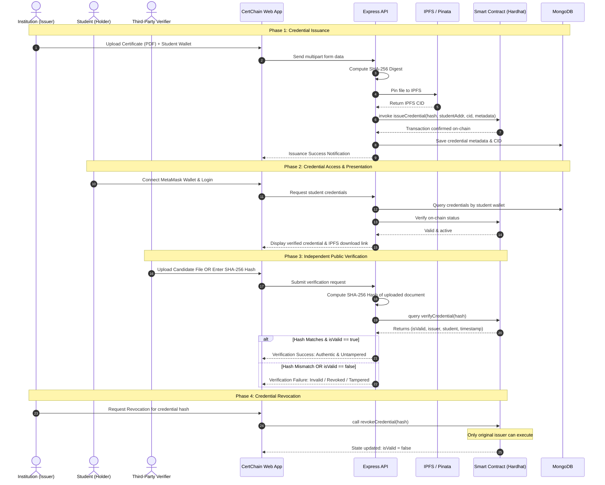

# 🎓 CertChain — A Blockchain-Based Decentralized Digital Credential Management System for Students

[](https://www.ieee.org/)
[](https://hardhat.org/)
[](https://soliditylang.org/)
[](https://pinata.cloud/)
[](https://reactjs.org/)
[](https://nodejs.org/)
[](https://drive.google.com/drive/folders/1Qw3DRJNPHg0UUw3Wn4dtf1ALQTRDjtUV?usp=drive_link)

> **Research Paper Presented at:**  
> **IEEE IGNITE 2.0: Student Research & Professional Awareness Conference**  
> *Title:* "A Blockchain-Based Decentralized Digital Credential Management System for Students"  
> *Affiliation:* Department of Computer Science (Artificial Intelligence), Vishwakarma Institute of Technology, Pune, India  
>
> **Authors:**
> - **Aditya Rana** ([aditya.rana24@vit.edu](mailto:aditya.rana24@vit.edu))
> - **Nitish Sahu** ([nitish.sahu24@vit.edu](mailto:nitish.sahu24@vit.edu))
> - **Palash Sahuji** ([palash.sahuji24@vit.edu](mailto:palash.sahuji24@vit.edu))
> - **Manthan Sali** ([manthan.sali24@vit.edu](mailto:manthan.sali24@vit.edu))  
> 
> **Project Guide:** **Prof. Anita Dombale** ([anita.dombale@vit.edu](mailto:anita.dombale@vit.edu))

---

## 📌 Abstract

Digital certificates in modern academic and professional landscapes demand heightened security, tamper-resistance, and verifiable integrity. Traditional centralized databases suffer from single points of failure, administrative opacity, vulnerability to unauthorized modification, and sluggish, manual cross-institution verification workflows. 

**CertChain** presents an end-to-end decentralized framework combining **Ethereum smart contracts (Solidity)**, **content-addressed storage via IPFS (Pinata)**, and a modern **React + TypeScript + Node.js** web application. By decoupling high-payload certificate files from ledger state, CertChain anchors only cryptographic **SHA-256 digests**, wallet addresses, issuance timestamps, and validity status on-chain. This hybrid approach guarantees permanent immutability and instant public verification while maintaining gas efficiency and off-chain retrieval speeds.

---

## 🏛️ System Architecture & Separation of Concerns

```
+-----------------------------------------------------------------------------------+
|                                  USER INTERFACE                                    |
|   React 18  *  TypeScript  *  Vite  *  Tailwind CSS  *  MetaMask Web3 Wallet       |
|            [ Issuer Portal ]   [ Student Dashboard ]   [ Verifier Portal ]         |
+-----------------------------------------------------------------------------------+
                                       |
                                       v
+-----------------------------------------------------------------------------------+
|                               BACKEND SERVICES                                    |
|    Node.js  *  Express  *  JWT Authentication  *  Role-Based Access Control (RBAC) |
|    * SHA-256 Hash Digest Engine   * Pinata IPFS Gateway Client   * Ethers.js v6    |
+-----------------------------------------------------------------------------------+
             |                                |                              |
             v                                v                              v
+------------------------+  +----------------------------------+  +------------------+
|   BLOCKCHAIN LEDGER    |  |        DECENTRALIZED IPFS        |  |  OFF-CHAIN DB    |
|  Solidity Smart Contract|  |         Storage (Pinata)         |  |     MongoDB      |
|  * CredentialStorage   |  | * Raw PDF / Certificate Document |  | * User Accounts  |
|  * SHA-256 File Hash   |  | * Content Identifier (CID)       |  | * Role Profiles  |
|  * Issuer / Student Addr|  | * Tamper-evident, Content-Addressed| * Fast Metadata  |
|  * Timestamps & Status |  |                                  |  |   Query Cache    |
+------------------------+  +----------------------------------+  +------------------+
```

### Tri-Layer Storage Model:
1. **Blockchain (Ethereum / Hardhat Network):**  
   Stores verifiable cryptographic proof — SHA-256 certificate hash, Issuer public address, Student public address, unix issuance timestamp, and boolean validity flag (`isValid`).
2. **Decentralized Storage (IPFS via Pinata):**  
   Stores the raw certificate files (PDF/Images) off-chain. Files are referenced through immutable Content Identifiers (CIDs), preventing ledger bloat.
3. **NoSQL Database (MongoDB):**  
   Indexes user records, metadata, role permissions, and cached CIDs for sub-second UI search, filtering, and role-based access control.

---

## 🔄 Complete Credential Lifecycle



---

## 📊 Experimental Evaluation & Performance Benchmarks

The prototype was rigorously evaluated on a local research testbed (Local Hardhat Node, Node.js runtime, MongoDB Atlas/Local, Pinata Cloud Gateway). The benchmark results from **Table 1** of our IEEE conference paper:

| Operation | Typical Latency Range | Description |
|:---|:---:|:---|
| **User Registration** | `50 – 100 ms` | Argon2/Bcrypt salted hashing and MongoDB insertion |
| **User Login (JWT Auth)** | `50 – 80 ms` | Credential validation and signed JWT issuance |
| **SHA-256 Cryptographic Hashing** | `< 10 ms` | Chunked file digest calculation in memory |
| **IPFS Upload (Pinata)** | `1 – 3 s` | Multipart file stream to decentralized Pinata nodes |
| **Blockchain Transaction** | `0.5 – 1 s` | Hardhat mining, state transition, and event emission |
| **Credential Issuance (Total)** | `2 – 5 s` | End-to-end pipeline (Upload → Hash → IPFS → On-Chain → DB) |
| **Credential Verification** | `100 – 300 ms` | Direct hash recomputation and on-chain view call |

---

## 🛡️ Security & Integrity Analysis

- **Tamper Detection by Cryptographic Collision Resistance:**  
  Any minute change in the certificate file (even a single byte alteration) generates a completely disparate SHA-256 hash ($x \ne y \implies H(x) \ne H(y)$). The verifier portal instantly flags the mismatch against the on-chain immutable hash.
- **Sybil & Unauthorized Revocation Defense:**  
  The smart contract enforces strict sender authentication (`require(msg.sender == credentials[hash].issuer, "Only issuer can revoke")`).
- **Decentralized Availability:**  
  Decoupled IPFS storage avoids reliance on a single institutional file server. Certificates remain reachable worldwide via their unique CID.
- **Zero Sensitive Data on Public Ledger:**  
  Personally Identifiable Information (PII) is kept off-chain; only cryptographic proofs and non-reconstructable hashes are broadcast to the distributed ledger.

---

## 💻 Tech Stack

| Domain | Technology | Purpose |
|:---|:---|:---|
| **Frontend Framework** | React 18, TypeScript, Vite | High-performance SPA with strict typing |
| **Styling & Components**| Tailwind CSS, Radix UI, Lucide Icons | Responsive modern interface & accessibility |
| **Web3 & Wallet** | Ethers.js v6, MetaMask | EVM interaction, transaction signing, account state |
| **Backend Runtime** | Node.js, Express.js | REST API, cryptographic utilities, middleware |
| **Database** | MongoDB, Mongoose ODM | Metadata caching, user authentication storage |
| **Smart Contracts** | Solidity (`^0.8.20`), Hardhat | Contract compilation, testing, local blockchain |
| **Decentralized Storage**| IPFS, Pinata API | Content-addressed storage for certificate files |

---

## 📁 Repository Structure

```
Cert-Chain-/
├── backend/
│   ├── config/
│   │   ├── CredentialStorageABI.json    # Compiled smart contract ABI
│   │   ├── db.js                        # MongoDB Mongoose connection
│   │   └── deployment.json              # Deployed contract address registry
│   ├── contracts/
│   │   └── CredentialStorage.sol        # Solidity smart contract
│   ├── controllers/
│   │   ├── authController.js            # User signup, login, profile management
│   │   └── credentialController.js      # Issue, verify, revoke & query logic
│   ├── middleware/
│   │   └── auth.js                      # JWT validation and RBAC authorization
│   ├── models/
│   │   ├── Credential.js                # Mongoose schema for credentials & CIDs
│   │   └── User.js                      # Mongoose schema for users & roles
│   ├── routes/
│   │   ├── authRoutes.js                # Auth endpoints
│   │   └── credentialRoutes.js          # Credential REST API routes
│   ├── scripts/
│   │   └── deploy.js                    # Hardhat contract deployment automation
│   ├── services/
│   │   └── blockchain/
│   │       └── blockchainService.js     # Ethers.js provider & contract abstraction
│   ├── utils/
│   │   └── ipfs.js                      # Pinata IPFS integration client
│   ├── hardhat.config.js                # Hardhat network & compiler configuration
│   ├── reset-db.js                      # Database reset test utility
│   ├── server.js                        # Express server entry point
│   ├── package.json
│   └── .env.example                     # Environment template
│
├── frontend/
│   ├── src/
│   │   ├── components/
│   │   │   ├── ui/                      # Reusable UI primitives (dialog, button, cards)
│   │   │   ├── CredentialTable.tsx      # Tabular credential viewer
│   │   │   ├── FileUpload.tsx           # Drag-and-drop file upload component
│   │   │   ├── VerificationResult.tsx   # Visual on-chain verification badge
│   │   │   └── WalletConnectButton.tsx  # MetaMask connect/disconnect controller
│   │   ├── contexts/
│   │   │   └── AuthContext.tsx          # React Authentication & User Context
│   │   ├── layouts/
│   │   │   └── DashboardLayout.tsx      # Sidebar, navbar, and role container
│   │   ├── pages/
│   │   │   ├── LandingPage.tsx          # Public hero & feature overview
│   │   │   ├── LoginPage.tsx            # Login with role routing
│   │   │   ├── RegisterPage.tsx         # Account registration
│   │   │   ├── IssuerDashboard.tsx      # Issuer analytics & quick actions
│   │   │   ├── IssueCredentialPage.tsx  # File upload & issuance form
│   │   │   ├── StudentDashboard.tsx     # Student portfolio & wallet status
│   │   │   ├── VerificationPortal.tsx   # Public independent certificate verifier
│   │   │   └── VerifierDashboard.tsx    # Verifier history & audit trail
│   │   ├── services/
│   │   │   └── api.ts                   # Axios client with JWT interceptors
│   │   ├── App.tsx                      # App router configuration
│   │   └── main.tsx                     # React DOM entry point
│   ├── index.html
│   ├── tailwind.config.ts
│   ├── vite.config.ts
│   └── package.json
│
└── README.md                            # Comprehensive project & conference guide
```

---

## 🚀 Quickstart & Local Setup Guide

Follow this step-by-step guide to run the complete system locally.

### 1. Prerequisites
- **Node.js** (v18 or higher recommended)
- **MongoDB** running locally (`mongodb://127.0.0.1:27017`) or a MongoDB Atlas URI
- **MetaMask Browser Extension** installed in Chrome/Brave/Edge
- Free [Pinata Cloud](https://pinata.cloud/) account for IPFS API credentials

---

### 2. Environment Configuration

Navigate to the `backend/` directory and configure `.env`:
```bash
cd backend
cp .env.example .env
```
Fill in the following variables inside `backend/.env`:
```env
PORT=5000
MONGODB_URI=mongodb://127.0.0.1:27017/certchain
JWT_SECRET=your_super_secret_jwt_key
PINATA_API_KEY=your_pinata_api_key
PINATA_SECRET_API_KEY=your_pinata_secret_key
PINATA_JWT=your_pinata_jwt_token
BLOCKCHAIN_RPC_URL=http://127.0.0.1:8545
CONTRACT_ADDRESS=0x5FbDB2315678afecb367f032d93F642f64180aa3
```

---

### 3. Execution (4 Dedicated Terminals)

Open 4 separate terminal tabs in your IDE:

#### 🔹 Terminal 1: Start Local Hardhat Blockchain
```powershell
cd backend
npx hardhat node
```
> *Keep this running.* Hardhat will print 20 test accounts with 10,000 test ETH each.
> Note: **Account #0** will serve as the primary **Issuer**.

#### 🔹 Terminal 2: Compile & Deploy Smart Contract
```powershell
cd backend
npx hardhat run scripts/deploy.js --network localhost
```
> The script deploys `CredentialStorage.sol` to local network `http://127.0.0.1:8545` and outputs the deployed address (e.g. `0x5FbDB2315678afecb367f032d93F642f64180aa3`).

#### 🔹 Terminal 3: Start Node.js / Express Backend Server
```powershell
cd backend
node server.js
```
> Connects to MongoDB, initializes the blockchain provider, and listens on `http://localhost:5000`.

#### 🔹 Terminal 4: Launch Frontend React Web Application
```powershell
cd frontend
npm run dev
```
> Launches the Vite dev server. Open **`http://localhost:8080`** in your browser.

---

### 4. MetaMask Wallet Configuration

1. In MetaMask, click **Networks** → **Add Network** → **Add a network manually**:
   - **Network Name:** Hardhat Localhost
   - **New RPC URL:** `http://127.0.0.1:8545`
   - **Chain ID:** `31337`
   - **Currency Symbol:** `ETH`
2. **Import Test Accounts:**
   - **Issuer Account:** Import using Private Key for Hardhat Account #0:
     `0xac0974bec39a17e36ba4a6b4d238ff944bacb478cbed5efcae784d7bf4f2ff80`
   - **Student Account:** Import using Private Key for Hardhat Account #1:
     `0x59c6995e998f97a5a0044966f0945389dc9e86dae88c7a8412f4603b6b78690d`

---

## 🧪 Testing the Complete Workflow

1. **Issuer Workflow:**
   - Sign up / Log in with role **Issuer**.
   - Connect MetaMask using **Account #0**.
   - Navigate to **Upload / Issue Credential**.
   - Paste the Student Wallet Address (`0x70997970C51812dc3A010C7d01b50e0d17dc79C8`), fill student details, attach a certificate document, and click **Issue Credential**.
   - Confirm the transaction in MetaMask.
2. **Student Workflow:**
   - Switch MetaMask to **Account #1**.
   - Log in with role **Student**.
   - View the issued credential in your portfolio, inspect the verified on-chain timestamp, and download the original file from IPFS.
3. **Verifier Workflow:**
   - Navigate to the public **Verification Portal**.
   - Upload any document or paste a SHA-256 hash.
   - The portal re-calculates the digest and performs an on-chain check in `< 300 ms`, returning full authenticity and validity status.

---

## 📂 Project Resources (Paper, PPT & Supporting Docs)

All research paper documents, conference presentation slides, supporting diagrams, and supplementary resources are available on Google Drive:

> 🔗 **[Access Google Drive Folder → CertChain Project Resources](https://drive.google.com/drive/folders/1Qw3DRJNPHg0UUw3Wn4dtf1ALQTRDjtUV?usp=drive_link)**

This folder contains:
- 📄 IEEE conference research paper (PDF)
- 📊 Presentation slides (PPT/PDF)
- 🗂️ Supplementary diagrams and architecture visuals
- 📸 Project demo screenshots and benchmarks

---

## 📑 Research Citation

If you use or reference CertChain in your research or project, please cite:

```bibtex
@inproceedings{rana2026certchain,
  title={A Blockchain-Based Decentralized Digital Credential Management System for Students},
  author={Rana, Aditya and Sahu, Nitish and Sahuji, Palash and Sali, Manthan and Dombale, Anita},
  booktitle={IEEE IGNITE 2.0: Student Research \& Professional Awareness Conference},
  year={2026},
  organization={Department of Computer Science (Artificial Intelligence), Vishwakarma Institute of Technology, Pune, India}
}
```

---

## 📜 License

This project is licensed under the **MIT License** — open for academic, educational, and open-source enhancement.
